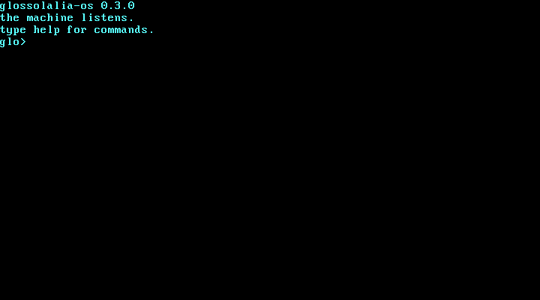

# glossolalia

> *utterance is execution. the machine listens.*

**Glossolalia** is a real, interpreted programming language. Its syntax reads
like incantation — spoken, rhythmic, intentional. Every keyword was chosen to
sound like something when read aloud. Code is scripture. Execution is ritual.

Tuned to 432hz aesthetics: natural, resonant, slightly outside consensus
reality.

```
speak "glossolalia"
burn 432
drift 1
hush
```

---

## the first utterance

```
git clone https://github.com/noisyloop/glossolalia
cd glossolalia
python3 -m glo.cli run examples/hello.glo
```

Or install it and get the `glo` command:

```
pip install -e .
glo run examples/hello.glo
glo repl
```

No build step. No transpilation. No toolchain. You speak, and the machine
listens.

---

## the tongue

Names are bound with `let` and changed with `set`:

```
let freq be 432
set freq to 528
add freq by 8
```

Tones are burned. Time drifts. Loops repeat and run until:

```
repeat 8
  burn freq
  drift 0.5
end

until freq below 100
  fall freq by 12
end
```

Functions are **incantations**. They take, they echo:

```
incant fifth takes f
  echo f scale by 1.5
end

speak call fifth with 432     ~ 648.0
```

Values gather into **strands**, and the machine **remembers**:

```
let intervals be weave 1, 1.25, 1.5, 2
repeat ratio in intervals
  burn 432 scale by ratio
end

sigil root be 432          ~ a sigil is fixed; it cannot be changed
remember tonic as root     ~ memory survives every scope

speak ascend root          ~ 864   (an octave up)
speak count intervals      ~ 4
let words be fracture "as above so below" by " "
speak converge words by "-"
chant 3 "resonance"
```

And the choir sings in many threads at once:

```
voice low
  repeat 8
    burn 432
    drift 2
    breathe
  end
end

voice high
  repeat 8
    burn 648
    drift 2
    breathe
  end
end

sync voices
silence
```

---

## the bare tongue (for machines with no heap)

A second, smaller tongue sits beneath the first, for writing operating
systems and compilers (see glossolalia-os). It adds hex literals, pulses
that **wrap** inside their width, and words that touch the machine:

```
let b be p8 250
add b by 10                      ~ b is 4: 260 wraps inside 8 bits
rite                             ~ the hardware words work only in a rite
  inscribe p16 0x0F41 at 0xB8000     ~ write memory
  speak peek p8 0xB8000              ~ read memory
  whisper p8 0x2A to port 0xE9       ~ write an I/O port
  speak listen port 0xE9             ~ read one
end
ward 0x21                        ~ an interrupt handler (declared, not fired)
  hush
end
```

The interpreter simulates the RAM and the ports, so bare scrolls run (and
can be tested) anywhere. `peek inscribe whisper listen port` are ordinary
names outside a rite.

Scrolls can also read and write files and talk to their caller:

| word                     | does                                              |
| ------------------------ | ------------------------------------------------- |
| `unseal <path>`          | the file's text, as a glyph                       |
| `engrave <glyph> to <path>`   | write a file (`onto` appends)                |
| `bones <glyph>` / `flesh <strand>` | glyph <-> strand of UTF-8 bytes         |
| `heed`                   | the words after the scroll on the command line    |
| `depart [code]`          | stop, with an exit status                         |

```
glo run compiler.glo --target linux in.glo    ~ heed = weave "--target", ...
```

---

## the machine speaks when it does not understand

Glossolalia never says `SyntaxError: unexpected token`. It speaks back in its
own tongue:

```
the machine did not understand "flarb" on line 4
an incantation named "chord" has not been spoken yet on line 1
the name "ghost" was set before it was ever spoken with "let" on line 2
```

---

## sound & signal

`burn` synthesises a real sine wave through your speakers when an audio backend
is present:

```
pip install -e ".[audio]"      # sounddevice + numpy
```

With no device — a server, CI, a quiet laptop — `burn` falls back to a
**visible tone**, so every scroll runs everywhere:

```
~   432.00hz  ▁▁▁▁▁▁▁▁█▁▁▁▁▁▁▁▁  (0.50s) ~
```

And it bridges to Ableton and friends over OSC:

```
pip install -e ".[osc]"        # python-osc
```

```
send "/glo/freq" 432
send "/glo/trigger" 1
```

---

## the commands

| Command              | Does                                              |
| -------------------- | ------------------------------------------------- |
| `glo run <scroll>`   | execute a scroll                                  |
| `glo repl`           | live interactive utterance                        |
| `glo check <scroll>` | validate syntax without running                   |
| `glo trace <scroll>` | run, printing the AST + an execution trace        |
| `glo serve [--port]` | raise a congregation — a shared live REPL         |
| `glo join <host>`    | add your voice to a congregation                  |

---

## the scrolls

Each `.glo` file is a scroll. Bring another scroll's incantations into yours
with `invoke`:

```
invoke "tunings"
speak call solfeggio with 3
```

Bundled standard-library scrolls: `tunings`, `rhythms`, `waveforms`.

---

## the congregation — many voices, one machine

A congregation is a live, multiplayer shared interpreter. One process holds the
state; many terminals speak into it over WebSockets. What one voice utters,
every machine hears and executes. When a session ends, so does the
congregation — there is no cloud, no persistence, no server in between. You
raise it, you own it.

```
pip install -e .        # websockets ships with the interpreter now
glo serve               # raise a congregation on :7432
```

In another terminal — or on another machine on the same network — add your
voice:

```
glo join localhost
```

Each voice is given a name from the choir (`low`, `mid`, `high`, `root`,
`fifth`, `ghost`) and a colour. Then:

```
low  ⟫ remember tonic as 432      ~ shared truth: every voice reads it
mid  ⟫ speak tonic                ~ 432
low  ⟫ burn ascend tonic          ~ the waveform appears in every terminal
mid  ⟫ let mine be 7              ~ local — yours alone, never broadcast
low  ⟫ sync voices                ~ blocks until everyone breathes
mid  ⟫ breathe                    ~ … and the congregation moves as one
mid  ⟫ \who                       ~ list the gathered voices
low  ⟫ \part                      ~ leave gracefully
```

`remember` and `sigil` are the congregation's shared state. Local `let`/`set`
stay with the voice that spoke them. If a voice goes silent mid-`sync`, the
barrier releases and the machine says so. The shared evaluator never crashes
the choir — a faulty utterance is spoken back as an error and the gathering
plays on.

The congregation was built for live performance: two people at terminals, or
ten across a studio floor, shaping a single interpreter in real time. The
session is the instrument. When you close it, it is gone.

---

## learn the whole language

- **[SPEC.md](SPEC.md)** — the complete language specification.
- **[THREAT_MODEL.md](THREAT_MODEL.md)** — the STRIDE threat model and the
  interpreter's security posture.
- **[examples/](examples/)** — scrolls to run and read.

---

## the shape of the work

| Phase            | What                                             | Status |
| ---------------- | ------------------------------------------------ | ------ |
| 1 — Utterance    | lexer, parser, evaluator, primitives, `glo run`  | ✅      |
| 2 — Tongue       | math, control flow, bindings, incantations       | ✅      |
| 3 — Choir        | voices, audio, OSC, the scroll/`invoke` system   | ✅      |
| 4 — Scripture    | `repl` / `check` / `trace`, spec, packaging      | ✅      |
| 5 — Congregation | shared live REPL over WebSockets — `serve/join`  | ✅      |

---

*glossolalia — noisyloop. tuned to 432.*

---

## glossolalia-os

A small, offline, 32-bit x86 operating system written in
[Glossolalia](https://github.com/noisyloop/glossolalia), plus a compiler for
Glossolalia written in Glossolalia itself. It is a **learning project**: the
code is meant to be read, every file says *why* it exists, and where there
was a simple way and a fast way, the simple way won.

> The deliverable is a bootable ISO that runs in QEMU. No network stack, no
> NIC drivers, no sockets — QEMU runs with `-nic none`, forever.

### What is in the box

| path | what |
|---|---|
| `SPEC-BARE.md` | language spec v0.2: the **bare** and **full** tongues, and every design choice with its alternatives |
| `glossc/` | the compiler, in `.glo`: `lexer` → `parser` → `gen` (NASM) |
| `rt/` | the runtime, in the bare tongue: console, numbers, bit-operation definitions |
| `targets/` | the only non-`.glo` code: short, line-by-line-commented NASM glue (`linux.asm`, `kernel.asm`) |
| `kernel/` | the operating system, in `.glo` (`main.glo`), and the self-test kernels (`test_*.glo`) |
| `examples/bare/` | programs that run on the interpreter *and* as native binaries |
| `tools/glorun.py` | runs a scroll on the interpreter with room for a compiler to breathe |
| `ostests/` | `pytest`: parity, compiler errors, (later) headless QEMU boots |
| `JOURNAL.md` | what each milestone taught about how an operating system works |

### The bootstrap plan

`glossc` is written in `.glo`. At first it runs on the existing Python
interpreter (`../glossolalia`). Once it can compile itself (milestone 7),
the interpreter is no longer needed to build anything.

```
glossc.glo --(Python interpreter)--> glossc.asm --nasm--> glossc (native, stage 1)
glossc.glo --(stage 1)-----------> glossc.asm  ==  the asm above, byte for byte
```

### Packages (Arch Linux)

```
sudo pacman -S nasm qemu-system-x86 qemu-audio-pipewire grub libisoburn mtools python python-pytest
```

(`libisoburn` provides `xorriso`, which `grub-mkrescue` needs; `mtools`
makes the FAT image GRUB's EFI part uses.) On Debian/Ubuntu: `nasm
qemu-system-x86 grub-pc-bin grub-common xorriso mtools python3 python3-pytest`.
The interpreter is this repository (`glo/`); nothing else to install.

### Commands

```
make iso      # build/glossolalia.iso  (glossc -> nasm -> grub-mkrescue)
make run      # boot it: qemu-system-i386 -cdrom ... -nic none, sound via PipeWire
make test     # interpreter tests + compiler tests + headless QEMU boots
make clean
```

`make run` is exactly

```
qemu-system-i386 -cdrom build/glossolalia.iso -nic none -audiodev pipewire,id=snd -machine pcspk-audiodev=snd
```

The tests boot ISOs with `-display none -serial stdio` and QEMU's
`isa-debug-exit` device (port `0xf4`): a kernel that calls `depart N` ends
QEMU with status `(N<<1)|1`, which is how a test kernel reports pass/fail.
Every boot has a timeout. A few tests also ask the QEMU monitor to dump
video memory, so they read the actual screen.

Compile a program for Linux and run it:

```
python3 tools/glorun.py glossc/glossc.glo --target linux --home . -o /tmp/h.asm examples/bare/hello.glo
nasm -f bin -I ./ /tmp/h.asm -o /tmp/h && chmod +x /tmp/h && /tmp/h
```

### What you see when you boot it

```
glossolalia-os
the machine listens.
type help for commands.
glo> help
commands:
  help             this list
  echo <text>      say it back
  add <a> <b>      add two numbers (decimal or 0x hex)
  peek <address>   read a byte of memory
  ticks            milliseconds since boot
  uptime           seconds since boot
  burn <hz> [ms]   sound a tone (until silence, or for ms)
  silence          stop the tone
  halt             stop the machine
```

The same text appears on the screen (VGA text mode) and on COM1.

### Download the ISO (v0.3.0)

**[`releases/glossolalia-0.3.0.iso`](releases/glossolalia-0.3.0.iso)** (5 MB, i386, GRUB). Boot it offline:

```
qemu-system-i386 -cdrom releases/glossolalia-0.3.0.iso -nic none
```

sha256 `b799a35dae2a4083a8495fd1e27121d235eb15aa1ff46e313ba1bf3cab448bce`. Try `version` and `choir` at the prompt.



### Status

| milestone | | |
|---|---|---|
| 0 | interpreter: hex, sized pulses, bare words, files, bytes, argv, exit codes | done (on branch `claude/glossolalia-os` of `../glossolalia`) |
| 1 | glossc v0: bare tongue → NASM → Linux ELF, parity suite | done |
| 2 | first boot: Multiboot stub, VGA text + COM1, `make iso`, headless boot tests | done |
| 3 | GDT, IDT, PIC remap, `ward` handlers, PIT-driven `drift`, PS/2 keyboard (with timeouts), REPL | done |
| 4 | sound: `burn` / `silence` through the PC speaker (PIT channel 2); tests measure the pitch from a recorded WAV | done |
| 5 | heap allocator, glyph/strand runtime (`rt/heap.glo`, `rt/glyph.glo`, `rt/full.glo`) and the full-tongue back end (`glossc/genfull.glo`, tagged words) | done |
| 6 | the choir: `rt/choir.glo` + `switch_stacks` (`voice_spawn`, `voice_yield`; `fn_addr` word) | done as a library (no `voice`/`breathe` syntax yet); `choir` in the REPL |
| 7 | self-hosting: glossc compiles itself, byte-identical | done: `make selfhost` (the seed `bootstrap/glossc` builds the OS with no Python) |
| stretch | glossc inside the OS, GRUB-module ramdisk | not attempted |

What works today: a bootable, offline, GRUB-loaded kernel written entirely in
the bare tongue, compiled by a compiler written in Glossolalia (native since
0.3.0), with interrupts, timer, keyboard, a REPL, sound and cooperative voices.
What changed in 0.3.0: the compiler compiles itself (stage 1 and stage 2 are
byte-identical), so `make iso` needs only `bootstrap/glossc`, nasm and GRUB. Python is only the reference interpreter and the old test suite. Limit: pulses are 31-bit in the full tongue.

### Planned: an OSC connector for AI agents (not built yet)

Idea: let an AI agent write Glossolalia by itself, over [OSC](https://opensoundcontrol.org/)
(the same family of messages the tongue's sound side already speaks). The
compiler is now one native binary (`bootstrap/glossc`) that needs no Python, so
a small bridge can drive it directly:

| direction | OSC address | carries |
|---|---|---|
| agent → machine | `/glo/source` | `.glo` source text (and optionally `target`: `linux` or `kernel`) |
| machine → agent | `/glo/error` | compile errors, in the machine's voice, with the line number |
| machine → agent | `/glo/out` | what the compiled program printed |
| machine → agent | `/glo/exit` | the program's exit status |

The loop an agent would run: send source, read `/glo/error`; if there is none,
read `/glo/out` and `/glo/exit`, compare with what it expected, send a fix.
`glossc` already exits 1 with a one-line error, and `tools/test_full.sh` already
does the compile-run-compare step, so the bridge is mostly plumbing.
Open questions: a sandbox and time limit for running untrusted programs, and
whether `kernel` programs should boot in QEMU and stream COM1 back.
